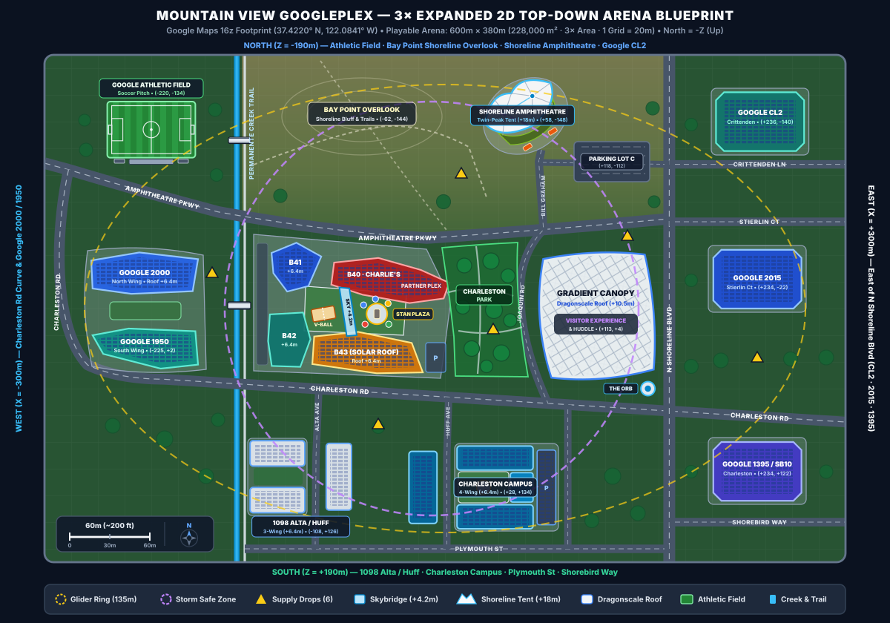

# Workspace Royale — Master Product, Design & Technical Specification

> **Document Purpose:** Single source-of-truth specification for building **Workspace Royale**, a high-fidelity, 100% self-contained **3D third-person Battle Royale web game** set at the **Googleplex** (Mountain View, CA). All 3D models (campus landmarks, embodied Google Workspace Product Icon AI characters, weapons, utilities) are authored reproducibly via headless **Blender 5.3.0 (`bpy` → `.glb`)** and rendered live at 60 FPS in any browser via **Three.js (WebGL2)**—requiring zero Blender runtime for end users visiting the web link.
>
> Designed to be fed directly into an AI coding agent or engineering team—and evaluated side-by-side across frontier models.

---

# PART I: PRODUCT SPECIFICATIONS

## 1. Product Vision & Core Pillars
**Workspace Royale** is a Fortnite/Valorant-inspired **3D third-person Battle Royale** set across a sunlit **Mountain View Googleplex** campus, playable directly via a static web link.

- **Product Identity = Embodied Workspace Product Icon AI + Signature Ultimate:** Players drop in as **6 sculpted 3D Google Workspace Product Icon AIs** (`Gmail AI`, `Drive AI`, `Calendar AI`, `Chat AI`, `Slides AI`, `Docs AI`), each built around an authentic 3D product icon chassis with an expressive dark-glass optical visor and sleek articulated AI arms and legs. Each Product AI grants a unique **Ultimate ability (`Q`)** powered by **Mana**.
- **Product-Agnostic Arsenal:** All guns, shields, and utility items belong to a **shared loot pool** across **3 rarity tiers**—any Workspace Product AI can pick up and wield any weapon or utility with full two-handed weapon IK and chest-carry locomotion.
- **High-Fidelity Stylized Realism:** Pixar / Astro-Bot / Portal caliber sculpted 3D Product Icon AIs with smooth beveled/subdivided contours, glossy ceramic/anodized-metal/dark-glass PBR materials, expressive optical visors, and articulated AI limbs (never crude/blocky Roblox cubes), paired with realistic beveled PBR tactical firearms, detailed utility hardware, and an authentic California golden-hour Googleplex campus.
- **Focused v1 Core Scope:** No material harvesting or freeform wall/ramp building in the initial version—tactical positioning relies on campus architecture, crouch-peeking, rooftop traversal, and lootable **Hard-Light Cover** barriers.

---

## 2. Playable Product AIs & Ultimates (6 Embodied Google Workspace Product Icon AIs)
All 6 embodied Product Icon AIs share identical base stats (`100 max Health`, `100 max Shield`, `100 max Mana`, `40 starting Mana`) and identical competitive hitboxes. Differentiation comes from their sculpted **3D Google Workspace Product Icon chassis**, **autonomous AI identity**, and **signature Ultimate (`Q`)**:

| Product AI | Workspace Product | Ultimate Ability (`Q`) | Mana Cost | Cooldown | Autonomous AI Role |
| :--- | :--- | :--- | :---: | :---: | :--- |
| **Gmail AI** | **Gmail** | **Reply-All Barrage:** Launches 6 homing explosive priority projectiles in an arcing volley targeting up to 3 nearby enemies (`34` splash dmg each, `5m` blast radius). | `60` | `16s` | Autonomous Inbox Striker AI — multi-target pressure & flush-out |
| **Drive AI** | **Google Drive** | **Access Revoked (Permission Guardrail):** Deploys a `12m`-radius **Restricted Access Guardrail Dome** for `6s` with crisp security bands: revokes enemy sharing permissions within `16m` (silencing enemy Ultimates & consumable channels for `3.0s`, knocking unauthorized foes outside the perimeter for `22` damage), cuts off incoming enemy projectiles across the guardrail boundary, and grants `+40 Shield` to the caster. | `55` | `18s` | Autonomous Cloud Security AI — area-denial guardrail & anti-ability anchor |
| **Calendar AI** | **Google Calendar** | **Hard Stop (Time Block):** Projects a `20m` chrono-field for `6s` that slows enemy movement (`-65%`) and fire rate (`-55%`) inside while granting the caster `+40%` move speed and `+45%` fire rate. | `55` | `17s` | Autonomous Chrono-Tempo AI — tempo controller & 1v1 duelist |
| **Chat AI** | **Google Chat** | **@all Ping Overload:** Emits an expanding `28m` emerald disruptor shockwave dealing `45` instant damage, draining `35` enemy Mana, and revealing **all living opponents** through cover and on the minimap for `8s`. | `50` | `15s` | Autonomous Comms Recon AI — recon flanker & info initiator |
| **Slides AI** | **Google Slides** | **Executive Spotlight:** After a crisp `0.3s` charge, fires a piercing golden orbital projection beam (`85m` range, `2.4m` width) down your crosshair dealing `85` damage + heavy knockback to every rival in line. | `60` | `16s` | Autonomous Spotlight Precision AI — precision line-of-sight finisher |
| **Docs AI** | **Google Docs** | **Version History (Rollback):** Continuously tracks your last `4.0s` of position, Health, and Shield. Activating `Q` rewinds you smoothly (`0.45s`) along a glowing blue Doc-cursor trail back to your `4.0s`-ago snapshot—restoring `max(current, saved)` Health & Shield, cleansing slows, auto-reloading your active weapon, and emitting a `12m` **Redline Pulse** (`35` dmg) at your departure point. | `55` | `17s` | Autonomous Version-Control Skirmisher AI — slippery skirmisher & clutch reset |

---

## 3. Core Gameplay Loop & Match Flow

### 3.1 Pre-Match Lobby
- **Interactive 3D Product AI Turntable:** Full-body, smoothly lit, drag-to-rotate 3D showcase of the selected Blender-exported Workspace Product Icon AI (`IdleArmed` breathing animation with two-handed weapon hold, clear 360° front & back view of the sculpted 3D icon chassis, dark-glass AI optical visor, articulated AI limbs, and held firearm).
- **Match Setup:**
  - Choose from **6 Embodied Workspace Product Icon AIs** (with Ultimate details & Mana cost).
  - Choose **Bot Intelligence Level:** `Casual (Intern)`, `Tactical (Staff)` *(default)*, `Pro (Distinguished)`, or `Mixed Lobby`.
  - Click **DROP INTO GOOGLEPLEX** to enter the Sky Drop phase.

### 3.2 Sky / Glider Drop-In Phase
- All **20 combatants** (1 Player + 19 AI Workspace Bots) deploy at `135m` altitude around the expanded `600m × 380m` Mountain View Googleplex perimeter ring under sleek Workspace-accented tactical gliders.
- **Controls:** Steer glide heading with `WASD` + mouse look to pick a drop landmark (Stan Plaza or Gradient Canopy for hot-drop Epic loot, Shoreline Amphitheatre or B40/B43 rooftops for high ground, Google 2000/1950, Charleston Campus, 1098 Alta, or East Shoreline offices for outer-ring gearing). Hold `Shift` to dive steeper and land faster.
- **Touchdown:** Within `3m` of ground/rooftop, the glider stows cleanly with a landing animation. Combatants land **completely unarmed** and must locate and open nearby **Tier 1–3 Loot Chests (`[E]`)** to arm up.

### 3.3 Vitals, Resources & Progression
- **Health (`0–100`):** Starts at `100`. Reaching `0` eliminates the combatant.
- **Shield (`0–100`):** **Starts at `0`** (unarmed drop-in; players & bots must loot Shield Cells or Aegis Shield Jugs from Loot Chests / Supply Drops). Absorbs gun & Ultimate damage before Health (Storm damage bypasses Shield directly into Health).
- **Mana (`0–100`):** **Starts at `40`** (intentional pacing: players cannot instantly fire Ultimates on landing—they must build Mana via passive `+4.5/sec` regen, eliminations `+30 Mana`, or looting **Mana Elixirs**).
- **No Building Materials in v1:** Building materials and freeform wall/ramp construction are explicitly excluded from the initial version. Tactical cover comes from Googleplex architecture, crouch-peeking, and lootable **Hard-Light Cover** items.

### 3.4 Mid-Match Supply Drops & Shrinking Storm
- **Mid-Match Supply Drops:** Three aerial Supply Drops deploy during the match (at the start of **Storm Phase 1**, **Storm Phase 2**, and **Storm Phase 3**) across **6 distributed campus drop zones** inside the next safe zone. Each descends under a parachute with a vertical golden beacon and lands with pulsing flare smoke + minimap marker. Opening (`E`, `1.5s` channel) bursts out **1 guaranteed Epic Weapon**, **1 Epic Shield/Medkit**, and **1 Epic Mana Elixir**.
- **5-Phase Battle Royale Storm (3× Campus Scale):**
  - Starts at `365m` radius and converges across 5 phases (`245m → 155m → 88m → 42m → 14m`) toward a randomized campus focal landmark for 5–8 minute match pacing.
  - Displays both the active translucent purple storm curtain (3D world + minimap) and a **white dashed next-safe-zone preview ring** on the minimap.
  - Out-of-zone damage per second across Phases 1–5: `2 / 4 / 7 / 10 / 15 HP/s`.
- **Match End:** Last product standing triggers **Victory Royale**; elimination displays placement (`#X / 20`), eliminations, headshot count, damage dealt, survival time, and one-click **Drop Again** / **Product AI Select**.

---

## 4. Combat & Movement Mechanics
- **Locomotion:** `WASD` movement (`8.5 m/s` jog, `12.8 m/s` sprint with `Shift`), `Space` jump (`12.2 m/s` impulse), and `C` / `Ctrl` **Crouch** (`4.8 m/s`, lowers eye/hitbox height from `1.82m` to `1.15m` for peeking behind courtyard planters/benches and tightens weapon spread by `45%`).
- **Third-Person Aiming & ADS:** Smooth over-the-right-shoulder camera (`FOV 68°`). Holding **Right Click (ADS)** zooms tightly over the shoulder (`FOV 46°`, slower strafe, reduced recoil/bloom). Holding ADS with the **Longbow .308 Sniper** activates a crisp magnified **Scope Overlay (`FOV 22°`)** with mil-dot reticle.
- **Headshot Critical Hits:** Dedicated sculpted head hitbox deals **`1.75x`** (`2.0x` on Longbow Sniper) damage with a golden crit hitmarker, elevated metallic audio "dink", and oversized gold floating damage numbers.
- **Directional Damage Indicator:** Taking hits flashes a translucent crimson directional arc around the crosshair pointing toward the attacker's world bearing (`1.1s` fade).
- **Consumable Channeling Timers:** Using healing/shield/mana consumables plays a third-person channel pose + circular progress ring around the crosshair:
  - **Shield Cell:** `1.5s` · **Mana Elixir:** `1.4s` · **Field Medkit:** `2.8s` · **Aegis Shield Jug:** `3.0s`.
  - Sprinting, jumping, firing, or switching slots cancels the channel cleanly without consuming the item.

---

## 5. Product-Agnostic Arsenal & 3-Tier Rarity System

### 5.1 Rarity Tiers (3 Levels)
| Tier | Name | Color | Damage / Potency Mult | Reload Speed Mult | Spawn Weight (Standard / High-Tier) |
| :---: | :--- | :--- | :---: | :---: | :---: |
| **1** | **Common** | Steel Gray (`#9aa0a6`) | `1.00x` | `1.00x` | `55%` / `15%` |
| **2** | **Rare** | Cobalt Blue (`#4285f4`) | `1.25x` | `0.88x` | `31%` / `45%` |
| **3** | **Epic** | Royal Purple (`#a855f7`) | `1.55x` | `0.76x` | `14%` / `40%` |

### 5.2 Weapons (5 Product-Agnostic Guns)
| Weapon | Class | Base Dmg | Headshot | Fire Rate | Mag | Reload | Range | Special Notes |
| :--- | :--- | :---: | :---: | :---: | :---: | :---: | :---: | :--- |
| **Vanguard M4** | Assault Rifle | `20` | `1.75x` | `6.4/s` | `30` | `1.8s` | `125m` | Balanced full-auto mid-range carbine |
| **Breaker 12G** | Tactical Shotgun | `12 × 8` | `1.6x` | `1.2/s` | `6` | `2.1s` | `38m` | 8-pellet spread; lethal close quarters |
| **Vector-9** | SMG / PDW | `13` | `1.75x` | `11.0/s` | `36` | `1.45s` | `70m` | Ultra-high RPM close/mid shredder |
| **Longbow .308** | Marksman Sniper | `68` | `2.0x` | `0.75/s` | `5` | `2.4s` | `220m` | Scoped ADS overlay; Epic headshot 1-taps unshielded foes |
| **Nova GL-40** | Ordnance Launcher | `56` | — | `0.85/s` | `4` | `2.5s` | `95m` | Arcing explosive (`6.5m` splash), destroys Hard-Light Cover fast, costs `8` Mana/shot |

### 5.3 Shields & Utility Items (6 Shared Pickups)
| Item | Category | Effect (Common / Rare / Epic) | Channel | Max Stack | Notes |
| :--- | :--- | :--- | :---: | :---: | :--- |
| **Shield Cell** | Shield | `+25 / +32 / +40` Shield | `1.5s` | `4` | Fast mid-fight top-up |
| **Aegis Shield Jug** | Shield | `+60 / +75 / +100` Shield | `3.0s` | `2` | Full shield reset behind cover |
| **Field Medkit** | Health | `+45 / +65 / +100` Health | `2.8s` | `3` | Primary Health recovery |
| **Mana Elixir** | Mana | `+45 / +65 / +100` Mana | `1.4s` | `3` | Accelerates Ultimate readiness |
| **Hard-Light Cover** | Tactical | Curved `240 / 300 / 380 HP` ballistic barrier | Instant | `3` | Costs `12` Mana; portable cover anywhere |
| **Impulse Booster** | Mobility | Directional high-arc vertical/forward launch | Instant | `3` | Costs `10` Mana; scale B40/B43 roofs or disengage |

**Unarmed Empty Start & Tier 1–3 Loot Chests:**
- **Zero Starter Gear:** Both the player and all 19 AI bots drop into the expanded Mountain View Googleplex **completely unarmed** (`Health 100`, `Shield 0`, `Mana 40`, all 5 hotbar slots empty) with **zero pre-existing bare ground loot** at match start. Picking up your first weapon automatically switches `activeSlot` to that weapon so you are immediately combat-ready.
- **Chest-Only World Loot (`prop_loot_chest.glb`):** ~145 campus loot spots across the Core Quad and all outer Mountain View rings spawn closed, hinged 3D **Loot Chests** across **3 Tiers** (visible on the 2D minimap and marked with a tier-colored vertical light beacon). Pressing `[E]` within `3.2m` triggers a crisp **`0.75s` opening channel** that swings `ChestLid` open along its rear hinge, bursts tier-colored sparkles, and ejects **1–3 items** in a semicircular arc in front of the chest:
  - **Tier 1 — Common Supply Chest (Bronze/Amber, ~50% standard spots):** Drops **1–2 items** (`45%` 1 item / `55%` 2 items; guaranteed `≥ 1` Weapon; rarity mix `75%` Common / `22%` Rare / `3%` Epic).
  - **Tier 2 — Rare Tech Chest (Cobalt Blue, ~35% standard / ~55% high-tier spots):** Drops **2–3 items** (`60%` 2 items / `40%` 3 items; guaranteed `≥ 1` Weapon + `1` Shield/Utility; rarity mix `25%` Common / `58%` Rare / `17%` Epic).
  - **Tier 3 — Epic Vault Chest (Royal Purple/Gold, ~15% standard / ~45% high-tier spots such as Stan Plaza, B40/B43 rooftops, Gradient Canopy, Shoreline Amphitheatre stage, Charleston Campus, Google 2000/1950, and East Shoreline offices):** Drops **3 items** (guaranteed `1` Rare/Epic Weapon + `1` Shield + `1` Utility/Mana Elixir; rarity mix `40%` Rare / `60%` Epic).
- Eliminated combatants still drop their looted gear on death, and mid-match **Supply Drops** still eject 3 guaranteed Epic items.

---

## 6. Configurable Bot Intelligence System
Players choose bot intelligence in the lobby (`Casual`, `Tactical`, `Pro`, or `Mixed Lobby` distributing bots 30% Casual / 45% Tactical / 25% Pro):

| Capability | Tier 1: Casual (`Intern`) | Tier 2: Tactical (`Staff`) | Tier 3: Pro (`Distinguished`) |
| :--- | :--- | :--- | :--- |
| **Aim & Lead** | Moderate scatter (`±2.4m`), center-mass aim, `550ms` reaction | Accurate (`±1.1m`), linear velocity lead, `300ms` reaction | Tight aim (`±0.45m`), full lead prediction + `22%` headshot rate, `140ms` reaction |
| **Looting & Supply Drops** | Picks up nearby ground loot opportunistically | Upgrades to Rare/Epic guns, maintains balanced AR + Shotgun/Sniper + Shield kit | Hot-drops high-tier landmarks, actively contests **Supply Drops**, loots elimination drops |
| **Positioning & Cover** | Slow strafe, fights in open | Strafe-weaves, ducks behind planters/umbrellas/walls, crouches to peek | Uses rooftop high ground (B40/B43/Bay View), stutter-strafes, deploys **Hard-Light Cover** under sudden fire, third-parties active fights |
| **Healing & Retreat** | Heals only below `35 HP` in place | Disengages behind cover to channel Shield Cells & Medkits when `<60%` vitals | Tactical retreat with Cover or Impulse Booster, heals cleanly out of line-of-sight |
| **Ultimate Mastery** | Casts Ultimate whenever Mana ready and enemy `<25m` | Contextual triggers (Drive Access Revoked when pushed, Docs Version History when `<45 HP`, Chat Ping before engaging) | Optimal combo timing (Calendar Hard Stop to win duels, Slides beam on sniper lines, Drive guardrail to cancel enemy channels, Docs rollback on burst) |
| **Storm Rotation** | Runs inward only after touching storm | Rotates inward `12s` before phase shrink | Pre-rotates early to elevated cover inside next dashed safe zone |

---

# PART II: VISUAL, SPATIAL & UX DESIGN SPECIFICATIONS

## 7. Art Direction & Lighting Palette
- **Atmosphere:** Bright, crisp **Mountain View late-afternoon California golden-hour sunlight** (`4:30 PM` warm sun azimuth casting crisp soft shadows, sky dome gradient from clear coastal azure zenith to warm golden horizon).
- **Material & Color Philosophy:** PBR materials with genuine surface contrast—glossy ceramic & anodized-aluminum AI icon chassis, curved tinted optical visor glass with bright emissive optics, brushed anodized gunmetal (`metalness 0.78, roughness 0.30`), matte textured rifle polymer (`roughness 0.80`), tinted reflective architectural curtain-wall glass, warm poured limestone/concrete, cedar timber, and iconic Google primary accents (`#4285F4`, `#EA4335`, `#FBBC04`, `#34A853`) placed naturally on umbrellas, GBikes, signage, and roof accents.

---

## 8. Embodied Google Workspace Product Icon AI Design Profiles (6 Playable AIs)
All 6 playable characters are **sleek, high-craft embodied 3D Google Workspace Product Icon AIs** (`~1.74–1.82m` tall, Pixar / Astro-Bot / Portal caliber — never blocky/Roblox cubes): each character's sculpted 3D torso IS the Google Workspace Product Icon itself (`Z ≈ 0.86m–1.74m`, slim depth `Y ∈ [-0.135m, +0.135m]` so two-handed rifles held across the chest never clip the chassis), built with smooth `BEVEL` / `SUBSURF` rounded contours, glossy ceramic/anodized-metal/dark-glass PBR materials, glowing emissive accents, **an expressive curved dark-glass AI optical visor with bright glowing eyes**, **sleek articulated AI arms** (tapered shoulder ball-joints, segmented ceramic/gunmetal upper & lower arms, ergonomic gripping hands for two-handed weapon IK & chest-carry running), and **agile athletic AI legs** (compact pelvis under the icon, tapered thighs, illuminated knee rings, athletic calves, and sleek futuristic sneaker-boots grounded cleanly at `Z = 0.000m`), recognizable in crisp 3D geometric relief from BOTH front and back:

1. **Gmail AI (`hero_gmail.glb`):** Sculpted rounded-bevel ceramic-white **3D Envelope Chassis** with thick raised 3D-beveled 4-color **Gmail `M` ribbon arch** (Blue left edge, Red center V-chevron, Yellow right fold, Green right edge) sculpted in crisp 3D relief on both front and back, dark-glass curved AI optical visor with bright expressive eyes tucked cleanly into the upper envelope brow, and red/white articulated AI limbs and boots.
2. **Drive AI (`hero_drive.glb`):** Sculpted **3D interlocking beveled Tri-Color Google Drive Triangle Prism Chassis** (chamfered angled Green left leg, Golden-Yellow right leg, Cobalt-Blue bottom bar with rounded folded corners, visible front and back) framing a dark-glass glowing **AI core screen and expressive cyan-emerald AI eyes** right inside the central triangular aperture, paired with slate/emerald articulated AI limbs and security guardrail wrist rings.
3. **Calendar AI (`hero_calendar.glb`):** Sculpted **3D rounded-corner Google Calendar Tile Chassis** framed in 3D beveled 4-color borders (Cobalt Blue top & left, Green bottom, Red bottom-right folded corner, Yellow right bar), recessed glossy white face featuring the iconic **`31` emblem** front and back, glowing dark-glass AI eye-visor integrated cleanly across the cobalt top header bar, and cobalt/white articulated AI limbs with a luminous chrono wrist-ring.
4. **Chat AI (`hero_chat.glb`):** Sculpted **3D layered Emerald Dual-Speech-Bubble Chassis** (smooth rounded-bevel emerald outer speech bubble with iconic folded upper-right tab and bottom-left speech tail, overlapping a luminous white/mint inner front bubble whose 3 glowing emerald **typing dots** form expressive AI optics/visor, plus crisp dual-bubble 3D relief on the back) with sleek emerald/dark-slate articulated AI limbs and agile boots.
5. **Slides AI (`hero_slides.glb`):** Sculpted **3D beveled Golden-Amber Dog-Eared Presentation Deck Chassis** (warm metallic/ceramic gold page body with a real 3D folded top-right dog-ear corner, crisp recessed white/dark-glass 16:9 slide screen on front and back housing expressive glowing golden AI optics and an upper-corner miniature holographic projector lens) paired with charcoal/gold articulated AI limbs.
6. **Docs AI (`hero_docs.glb`):** Sculpted **3D beveled Cobalt-Blue Document Page Chassis** with a real 3D folded top-right dog-ear corner, raised glossy 3D white **horizontal document text-line bars** (full upper lines, shorter bottom line) sculpted cleanly on both front and back, a curved dark-glass AI optical visor with bright sky-blue expressive eyes integrated into the upper header, and cobalt/white articulated AI limbs.

---

## 9. Realistic Weapon & Utility Visual Spec (Blender Modeled)
- **Guns (Zero Box Primitives):** Every gun features beveled metallic receivers, upper Picatinny rail notches, cylindrical fluted barrel with flash-hider/muzzle brake, ergonomic angled pistol grip, detachable box/curved magazine (or revolving drum on Nova GL-40), contoured buttstock, and detailed optics (reflex holographic housing on M4/Vector, cylindrical magnified scope with tinted lenses on Longbow .308). A dedicated `RarityAccent` trim material slot tints subtle anodized stripes & optic reticle glow (Steel Gray / Cobalt Blue / Royal Purple) without turning the whole weapon neon.
- **Utilities & Shields:** Beveled translucent glass/polymer **Shield Cells** & **Aegis Jugs** with glowing cyan liquid core, realistic hinged **Field Medkit** trauma case with medical cross, sleek cylindrical **Mana Elixir** flask with glowing violet energy core, folded **Hard-Light Cover** emitter disc, turbine-vented **Impulse Booster** thruster pack, and a detailed stenciled **Supply Drop** crate with parachute canopy & golden flare beacon.

---

## 10. 2D Overtop Map View & Spatial Layout — Expanded Mountain View Googleplex (`600m × 380m · 3×`)

> **Authentic Campus Reference:** Modeled directly on the zoomed-out Mountain View Googleplex footprint on Google Maps `16z` (`37.4220° N, 122.0841° W` — expanded **3.05×** in playable area from `74,800 m²` to **`228,000 m²`** across `600m × 380m`). Preserves the exact inner Core Googleplex (`B40–B43` Quad, Skybridge, Sand Volleyball, Stan T-Rex Plaza, Charleston Park, Joaquin Rd, Gradient Canopy / Visitor Experience, and The Orb) while adding the authentic surrounding Mountain View rings: **Shoreline Amphitheatre**, **Bay Point Shoreline Overlook**, **Parking Lot C**, and **Google Athletic Recreation Field** in the North; **Google 2000 & 1950 Complex** tucked inside the sweeping western curve of **Charleston Rd** in the West; **1098 Alta / Huff Complex**, **Charleston Campus**, and **Plymouth St** in the South; and **N Shoreline Blvd**, **Crittenden Ln**, **Stierlin Ct**, **Shorebird Way**, **Google CL2**, **Google 2015**, and **Google 1395 / SB10** in the East.
>
> **Visual Blueprint (Markdown Preview):** 

### 10.1 Scale-Accurate 2D Overtop Tactical Map (`X ∈ [-300m, +300m]`, `Z ∈ [-190m, +190m]`)
*(North = `-Z` [Up], South = `+Z` [Down], West = `-X` [Left], East = `+X` [Right]. Origin `(0, 0)` remains between Partner Plex / B43 and Charleston Park.)*

```text
                                     NORTH (Z = -190m) — Athletic Field · Bay Point · Shoreline Amphitheatre · CL2
        -300     -225     -156    -100     -50       0      +60     +120    +168     +235    +300
      +-------------------------------------------------------------------------+-----------------+ -190
      |   +------------+   ~ |    . . . BAY POINT . . .    /^^^\                |   +---------+   |
      |   | ATHLETIC   |   ~ |    . SHORELINE OVERLOOK .  /SHORE\  [LOT C]      |   | GOOGLE  |   | -140
      |   | FIELD      |   ~ |    .   (-62, -144)       . \LINE / (+118,-112)   |   |  CL2    |   |
      |   |(-220,-134) |   ~ |    .  Golden Bluffs/Trails  \AMP/   |Bill        |   |(+236,-140)  |
      |   +------------+   ~ |                            (+58,-148)|Graham     +===CRITTENDEN LN=| -108
      |--\                 ~ |                                      |           |                 |
      |   \==AMPHITHEATRE==~=+============== AMPHITHEATRE PKWY =====+===========+===STIERLIN CT===|  -65
      | /                  ~ | +-----+  +-----------------+  *   *  /  /~~~~~\  |   +---------+   |
      ||  +-------------+  ~ | | B41 |==| B40 (CHARLIE'S) | CHARL. /  /GRAD.  \ |N  | GOOGLE  |   |  -22
W     ||  | GOOGLE 2000 |  ~ | |(-112|  | & PARTNER PLEX  |  PARK |J | CANOPY  ||S  |  2015   |   |     E
E     ||  +-------------+  =[B]+--+--+  +---+---------+---+ (+28, |O |(+113,+4)||H  |(+234,-22)   |     A
S     ||   (-225, +2)      ~ | |  |[VB]/SKY\ [STAN] u |    | -10) |A |Dragonsc.||O  +---------+   |  +5 S
T     ||  +-------------+  ~ | +--+---+  |  +---------+    |  *   |Q |+10.5m   ||R                |     T
(-300)||  | GOOGLE 1950 |  ~ | | B42  |  |  | B43 (SOLAR) |[P]    \U |VISITOR  ||E                |(+300)
      ||  +-------------+  ~ | |(-117)|  +--+  (-58, +33) |        \I|EXP/HUDD.||L                |  +45
      | \                  ~ | +------+     +-------------+   *   * \+_________||I                |
      |  \===CHARLESTON====~=+================== CHARLESTON RD ======+====(ORB)=+===CHARLESTON RD=|  +70
      |     (-210,+53)     ~ |                       |   |           \          |N  +---------+   |
      |                    ~ | +----------+  |Alta   |Huff  +--------------+ \  |E  | GOOGLE  |   | +122
      |   .   SW LAWN   .  ~ | |1098 ALTA |  |Ave    |Ave   |  CHARLESTON  |  \ |   | 1395 /  |   |
      |                    ~ | |  / HUFF  |  |(-64)  |(-36) |   CAMPUS     |   \|   |  SB10   |   |
      |                    ~ | |(-108,+126)  |       |      |  (+28,+134)  |   ||   |(+234,+122)  |
      |                    ~ | +----------+  |       |      +--------------+   ||===SHOREBIRD WAY=| +160
      |                    ~ |===============+=======+====== PLYMOUTH ST ======++                 | +180
      +-------------------------------------------------------------------------+-----------------+ +190
                                      SOUTH (Z = +190m) — 1098 Alta/Huff · Charleston Campus · Plymouth St

LEGEND:
  ~ |     Permanente Creek (X=-156m) & Trail (X=-150m)  [B]   Pedestrian Footbridge (Google 2000/1950 <-> Quad)
  /^^^\   Shoreline Amphitheatre Twin-Peak Tent (+18m)  /SKY\ Elevated Diagonal Glass Skybridge (+4.2m)
  [VB]    Sand Volleyball Court (-91, +4)               [STAN] Stan T-Rex Plaza (-51, +4) + Google Umbrellas (u)
  *       California Live Oak Groves (Charleston Park)  (ORB) The Orb Art Plaza (+152, +60)
```

### 10.2 Exact Landmark Coordinates, Footprints & Gameplay Roles (`600m × 380m`)
| Landmark / Artery | Ring | Center `(X, Z)` | Footprint / Shape | Playable Elevation | Authentic Feature & Loot Bias |
| :--- | :---: | :---: | :--- | :--- | :--- |
| **Permanente Creek & Trail** | Core / N–S | `X = -156m` (Trail `-150m`) | Full N–S channel + bikeway (`Z ∈ [-190, +190]`) + pedestrian bridge (`Z ≈ -2m`) | Ground `0.0m` (Creek `-0.85m`) | Western creek corridor linking Athletic Field, Google 2000/1950, Core Quad & 1098 Alta; long sniper sightline |
| **Building 41 (`Google B41`)** | Core | `(-112, -31)` | Angled V-faceted 2-story hollow office (`36m × 34m`) | Ground + Interior + Roof `+6.4m` | NW Quad SWE hub with playable office interior, west parking strip & exterior rooftop stairs |
| **Building 42** | Core | `(-117, +23)` | Multi-faceted 2-story hollow office (`30m × 38m`) | Ground + Interior + Roof `+6.4m` | SW Quad design studio flanking the Sand Volleyball Court |
| **Sand Volleyball Court** | Core | `(-91, +4)` | Rectangular tan sand court (`18m × 10m`, angled `-10°`) | Ground `0.0m` | Iconic west-central courtyard landmark between B41, B42 & Skybridge |
| **Central Glass Skybridge** | Core | `(-73, +2)` | Diagonal covered glass walkway (`36m × 8m`) | Elevated `+4.2m` (Open underneath) | Links B40 & B43 directly across courtyard; two-level fights over & under |
| **Building 40 (`Charlie's` & `Partner Plex`)** | Core | `(-57, -25)` → `(-25, -17)` | Sweeping WNW–ESE hollow office wing (`86m × 30m`) | Ground + Interior + Roof `+6.4m` | N/NE Quad wing overlooking Charleston Park; Charlie's Café microkitchen patio (**Shields/HP/Mana**) |
| **Stan the T-Rex Plaza** | Core | `(-51, +4)` | Circular stone plaza (`r = 16m`) + Google umbrellas | Ground `+0.2m` (Pedestal `+2.0m`) | East-central courtyard centerpiece; **High-Tier Loot Chests** |
| **Building 43 (`Google B43`)** | Core | `(-58, +33)` | Staggered solar-roofed hollow office wing (`82m × 30m`) | Ground + Interior + Roof `+6.4m` | S/SE Quad wing along Charleston Rd; solar-panel roof cover + exterior stairs + SE parking pad `(-4, +38)` |
| **Charleston Park** | Core | `(+28, -10)` | Dense California Live Oak park (`64m × 98m`) | Contoured `0.0m–1.4m` | Lush oak groves, winding paved walkways, prime mid-map flank & **Supply Drop** zone |
| **Joaquin Rd & Bill Graham Pkwy** | Core / N–S | `(+74, -59)` → `(+57, -4)` → `(+77, +71)` → `(+92, +180)` | Sweeping N–S connector road (`7m` wide) | Ground `0.0m` | Connects Shoreline Amphitheatre & Lot C past Charleston Park / Gradient Canopy & Charleston Campus to Plymouth St |
| **Gradient Canopy (`Visitor Experience` & `Huddle`)** | Core | `(+113, +4)` | Rounded-square quilted dragonscale pavilion (`90m × 94m`) | Ground `+0.4m` (Canopy `+10.5m`) | Signature white diamond-quilted dragonscale roof, sunlit open atrium, Huddle microkitchen (**High-Tier Loot**) |
| **The Orb Plaza** | Core | `(+152, +60)` | Circular stone plaza (`r = 10m`) w/ metallic sphere | Ground `0.0m` | SE public art landmark at Charleston Rd & N Shoreline Blvd |
| **Shoreline Amphitheatre** | North | `(+58, -148)` | Twin-peak tensioned-fabric concert tent & bowl (`64m × 56m`) | Bowl `0–4m` / Tent Peaks `+18.0m` | Iconic white twin-peak concert venue facing SE w/ acoustic stage, terraced seating & concourse (**High-Tier Loot**) |
| **Bay Point Shoreline Overlook** | North | `(-62, -144)` | Contoured golden-green bluff & park trails (`X ∈ [-140, +20]`) | Rolling Hills `0.0m–4.5m` | Elevated northern ridge overlooking Amphitheatre Pkwy & Core Quad; long-range marksman sightlines |
| **Parking Lot C** | North | `(+118, -112)` | Striped amphitheatre asphalt parking lot (`58m × 40m`) | Ground `0.0m` | Open-air tactical crossing between Shoreline Amphitheatre, Bill Graham Pkwy & N Shoreline Blvd |
| **Google Athletic Recreation Field** | NW | `(-220, -134)` | Striped lush soccer pitch w/ goals & bleachers (`66m × 42m`) | Ground `0.0m` (Bleachers `+2.4m`) | Fast NW open-field skirmish arena with dugout & bleacher cover north of Amphitheatre Pkwy |
| **Google 2000 & 1950 Complex** | West | `(-225, +2)` | Curving dual-wing glass campus (`82m × 92m`) inside western Charleston Rd bend | Ground + Open Lobby + Roof `+6.4m` | Twin curving wings (2000 North / 1950 South) flanking a landscaped courtyard linked to Core Quad by creek footbridge |
| **1098 Alta / Huff Complex** | South | `(-108, +126)` | Twin-wing white-roofed campus (`76m × 54m`) | Ground + Lobby Arch + Roof `+6.4m` | Twin white-roofed buildings framing a central garden spine along Alta Ave & Huff Ave |
| **Charleston Campus** | South | `(+28, +134)` | Large multi-wing Google courtyard campus (`110m × 62m`) | Ground + Courtyard + Roof `+6.4m` | Major southern stronghold between Huff Ave, Joaquin Rd & Plymouth St; **High-Tier Loot** |
| **Google CL2 Crittenden** | NE | `(+236, -140)` | Modern glass-and-concrete office (`68m × 46m`, north of Crittenden Ln `Z=-108`) | Ground Arcade + Roof `+6.4m` | NE flank campus east of N Shoreline Blvd with rooftop solar arrays & exterior stairs |
| **Google 2015 / Stierlin Ct** | East | `(+234, -22)` | Modern glass-and-concrete office (`68m × 46m`, south of Stierlin Ct `Z=-65`) | Ground Arcade + Roof `+6.4m` | Directly east across N Shoreline Blvd from Gradient Canopy; prime eastern rotation hub |
| **Google 1395 Charleston / SB10** | SE | `(+234, +122)` | Modern glass-and-concrete office (`68m × 46m`, north of Shorebird Way `Z=+160`) | Ground Arcade + Roof `+6.4m` | SE corner campus south of Charleston Rd with open ground-floor arcade & rooftop cover |
| **Outer Road Network** | Perimeter | `N Shoreline Blvd (X=+168)`, `Amphitheatre Pkwy (Z≈-65)`, `Charleston Rd (curve (-282,-104)->(-210,+53) & Z≈+65)`, `Crittenden (-108)`, `Stierlin (-65)`, `Shorebird (+160)`, `Plymouth (+180)` | Multi-lane Mountain View arteries w/ lane markings & crosswalks | Ground `0.0m` | Seamless campus-wide rotation corridors separating all 4 outer rings from the Core Quad |

---

## 11. UI / HUD & Audio UX Spec
- **Minimalist Tactical Glassmorphism HUD:**
  - **Top-Left:** Live 2D tactical minimap (buildings, pathways, landmarks, **purple storm circle + white dashed next safe zone**, Supply Drop beacons, nearby/revealed enemy pings, player vision cone) + Zone Name + Storm countdown pill.
  - **Top-Center:** `ALIVE` / `ELIMS` counters, horizontal compass bearing strip (`N / NE / E / ...`) with Supply Drop markers, and event toast banners.
  - **Top-Right:** Animated kill feed (showing Headshot & Ultimate icons) + compact controls legend.
  - **Center:** Dynamic spread crosshair (tightens on crouch/ADS; switches to dark vignette mil-dot scope overlay on Longbow Sniper ADS), crimson **Directional Damage Arc**, crisp body/gold-crit hitmarkers, circular consumable channel ring, floating damage numbers (`Cyan` Shield / `White` Health / `Gold` Headshot Crit), and proximity loot prompt (`[E]`).
  - **Bottom-Left:** Hero portrait + crisp **Shield (cyan)**, **Health (green→red)**, and **Mana (violet)** bars.
  - **Bottom-Center:** Active weapon/item readout + ammo/reload bar + 5-slot rarity-bordered hotbar (`1–5`).
  - **Bottom-Right:** Product Ultimate readiness widget (`Q`) with live Mana/Cooldown status.
- **Procedural Web Audio API Soundscape:** Multi-layered distinct gunshots per weapon (transient crack + low punch + mechanical action), distance-attenuated distant bot firefights, crisp metallic headshot "dink", crystalline shield break shatter, consumable sip/zip audio, glider wind rush, Supply Drop horn, and distinct Ultimate audio stingers.

---

# PART III: TECHNICAL SPECIFICATIONS

## 12. Architecture & Deployment Model (Build-Time Blender → Static Web App)
- **Strict Separation of Build Time vs. Runtime:**
  - **Build Time (Local CLI / CI):** **Blender 5.3.0** runs headlessly (`blender --background --python ...`) to generate all high-poly 3D meshes, skeletal rigs, baked animations, and embedded PBR textures as standard **glTF 2.0 binary (`.glb`)** files into `public/assets/`.
  - **Runtime (End-User Website):** **100% static web bundle** (`Vite 6 + TypeScript strict + Three.js`) deployable to any static host (Firebase Hosting, Vercel, Netlify, Cloud Run, GitHub Pages). Visitors clicking the web link require **no Blender, no backend server, and no external CDNs**—everything renders live at 60 FPS via WebGL2 (`THREE.GLTFLoader` + `THREE.AnimationMixer`).
- **Zero-External-Asset Portability Rule:** All `bpy` scripts and TypeScript code must be **100% self-contained** (no fetching third-party `.glb` URLs, external HDRIs, or remote PNG/MP3 links). Procedural textures are synthesized deterministically using `numpy` inside Blender (packed directly into `.glb`) and HTML5 Canvas in Three.js.

---

## 13. Verified Blender 5.3.0 (`bpy`) Asset Pipeline Specification

### 13.1 Blender 5.3.0 API Compatibility Guardrails
All asset generation scripts under `scripts/blender/` must strictly conform to **Blender 5.3.0** (`Python` + bundled `numpy 2.3.4`):
- **Render Engine for Headless QA Previews:** Use `scene.render.engine = 'BLENDER_EEVEE'` *(do NOT use deprecated `'BLENDER_EEVEE_NEXT'`)*.
- **Principled BSDF Sockets:** Use `'Base Color'`, `'Metallic'`, `'Roughness'`, `'IOR'`, `'Alpha'`, `'Normal'`, `'Specular IOR Level'`, `'Emission Color'`, and `'Emission Strength'`. *(Avoid legacy 3.x socket names like `'Specular'` or `'Emission'`.)*
- **Textures Embedded in `.glb`:** Create images via `bpy.data.images.new(name, width, height, alpha=True)`, fill `img.pixels.foreach_set(arr.ravel())` with `numpy`, call `img.pack()`, and link through `ShaderNodeTexImage` so every texture embeds seamlessly inside the exported `.glb`.
- **Standardized glTF 2.0 Export Call:**
  ```python
  bpy.ops.export_scene.gltf(
      filepath=out_path,
      export_format='GLB',
      use_selection=True,
      export_yup=True,
      export_apply=True,
      export_materials='EXPORT',
      export_animations=include_animations,
      export_bake_animation=include_animations,
      export_draco_mesh_compression_enable=False, # Keep zero external WASM decoder dependency
  )
  ```
  *(Units: `1 Blender Unit = 1.0 meter`, character faces `+Y` in Blender which maps to `+Z` forward in Three.js with `export_yup=True`, feet grounded cleanly at `Z = 0.0`.)*

### 13.2 Modular Blender Generation Scripts & Required `.glb` Asset Manifest
Organize asset generation into **8 modular, runnable scripts** orchestrated by `npm run assets:build` producing **45 self-contained `.glb` assets**:

| Script | Export Directory & Files | Modeling & Topology Standards (Anti-"Roblox" Floor) |
| :--- | :--- | :--- |
| `scripts/blender/build_characters.py` | `public/assets/characters/` (**6 `.glb`s**)<br>• `hero_gmail.glb`<br>• `hero_drive.glb`<br>• `hero_calendar.glb`<br>• `hero_chat.glb`<br>• `hero_slides.glb`<br>• `hero_docs.glb` | • **Embodied 3D Workspace Product Icon Chassis:** `5,000–6,000` triangles per Product AI using `BEVEL` + `SUBSURF` rounded contours and smooth shading (`mesh.polygons.foreach_set('use_smooth', ...)`), sculpted in genuine 3D geometric relief recognizable front and back (Gmail M envelope, Drive interlocking tri-color triangle prism, Calendar 4-color `31` tile, Chat dual speech bubbles, Slides golden dog-eared presentation deck, Docs cobalt dog-eared lined page), curved dark-glass AI optical visor with bright glowing eyes, slim `Y ∈ [-0.135m, +0.135m]` chest clearance for zero rifle clipping, ceramic/anodized-metal PBR materials + crisp embedded `numpy` textures, and sleek articulated AI arms/hands & athletic AI legs/sneaker-boots grounded cleanly at `minZ = 0.000m`.<br>• **18-Bone Rig, Analytic 2-Bone IK & 12 Baked Animations:** Full 18-bone `Armature` (`Root`, `Pelvis`, `Spine`, `Chest`, `Neck`, `Head`, `UpperArm/LowerArm/Hand L/R`, `Thigh/Shin/Foot L/R`, plus `WeaponSocket_R` under `Hand_R` at `+90° X`) weighted cleanly so upper-body aim pitch tilts the icon chassis and arms smoothly without tearing; exact Analytic 2-Bone Arm IK for two-handed rifle grip (`Hand_R → Hand_L` runtime lock) and `0.00mm`-drift `Glide` handlebar clamp across **12 baked NLA animation clips**: `Idle`, `Run`, `Sprint`, `Crouch`, `Aim`, `Reload`, `Glide`, `Jump`, `IdleArmed`, `RunArmed` (two-handed chest-carry), `SprintArmed`, and `JumpArmed`. |
| `scripts/blender/build_weapons.py` | `public/assets/weapons/` (**5 `.glb`s**)<br>• `weapon_vanguard_m4.glb`<br>• `weapon_breaker_12g.glb`<br>• `weapon_vector_9.glb`<br>• `weapon_longbow_308.glb`<br>• `weapon_nova_gl40.glb` | • **Realistic Tactical Hardware:** `900–2,400` triangles per gun using `BEVEL` modifiers (`segments=2`), cylindrical fluted barrels, Picatinny top rails, contoured receivers, angled grips, curved/box magazines (or revolving drum), stocks, and detailed optics/scopes.<br>• **Materials & Sockets:** Brushed steel (`Metallic 0.8, Roughness 0.3`), matte polymer (`Roughness 0.8`), tinted optic glass, plus a named material slot **`RarityAccent`** (recolored dynamically at runtime for Common/Rare/Epic) and a named empty **`MuzzlePoint`** at the barrel tip. |
| `scripts/blender/build_utilities.py` | `public/assets/utilities/` (**9 `.glb`s**)<br>• `item_shield_cell.glb`<br>• `item_shield_jug.glb`<br>• `item_medkit.glb`<br>• `item_mana_elixir.glb`<br>• `item_hardlight_cover.glb`<br>• `item_impulse_booster.glb`<br>• `prop_supply_drop.glb`<br>• `prop_glider.glb`<br>• `prop_loot_chest.glb` | • Smooth beveled cylinders/capsules/trauma cases (`400–1,900` tris each), translucent tinted glass chambers with glowing inner liquid cores for Shield/Mana pickups, aerodynamic multi-ribbed tactical glider canopy for Sky Drop, detailed stenciled Supply Drop crate with folded parachute rigging, and a beveled armored **3D Loot Chest** (`prop_loot_chest.glb`) with a rear-hinged `ChestLid` node (`+100°` swing) and tintable `RarityAccent` glow strips for Tier 1–3 chests. |
| `scripts/blender/build_map.py` | `public/assets/map/` (**13 `.glb`s**)<br>• `landmark_stan_trex.glb`<br>• `landmark_b40_partnerplex.glb`<br>• `landmark_b41.glb`<br>• `landmark_b42.glb`<br>• `landmark_b43.glb`<br>• `landmark_skybridge.glb`<br>• `landmark_volleyball_court.glb`<br>• `landmark_gradient_canopy.glb`<br>• `landmark_orb_plaza.glb`<br>• `prop_umbrella_bistro.glb`<br>• `prop_gbike_rack.glb`<br>• `prop_oak_tree.glb`<br>• `prop_redwood_tree.glb` | • **Core Googleplex Landmarks & Props:** Anatomical **Stan the T-Rex** skeleton on tiered limestone pedestal; hollow playable 2-story **Googleplex Quad (B40/Partner Plex, B41, B42, B43)** with beveled concrete facades, curtain-wall glass mullions, rooftop solar arrays, exterior stairs & **elevated diagonal Glass Skybridge (`+4.2m`)**; **Sand Volleyball Court**; rounded-square diamond-quilted **Gradient Canopy (`+10.5m`)** & **The Orb** plaza; 8-panel scalloped Google umbrella bistro sets, GBike racks, and branching California Live Oak & Redwood trees. |
| `scripts/blender/build_office_props.py` | `public/assets/map/` (**5 `.glb`s**)<br>• `prop_desk_pod.glb`<br>• `prop_conference_pod.glb`<br>• `prop_microkitchen_bar.glb`<br>• `prop_lounge_nook.glb`<br>• `prop_whiteboard_wall.glb` | • **Playable Googleplex Interior Furniture:** Multi-monitor standing desk pods, glass-walled conference pods, Google microkitchen espresso/snack bars, colorful lounge nooks, and wheeled brainstorming whiteboard walls instanced across B40–B43 & Gradient Canopy interiors for tactical indoor CQB cover. |
| `scripts/blender/build_expanded_landmarks.py` | `public/assets/map/` (**6 `.glb`s**)<br>• `landmark_shoreline_amphitheatre.glb`<br>• `landmark_athletic_field.glb`<br>• `landmark_google_2000_1950.glb`<br>• `landmark_charleston_campus.glb`<br>• `landmark_alta_complex.glb`<br>• `landmark_shoreline_east_office.glb` | • **3× Expanded Mountain View Ring Landmarks (`~300–550 KB` each, grounded at `minZ = 0.000m`):**<br>  - **Shoreline Amphitheatre (`64m × 56m`, peaks `+18m`):** Iconic twin-peak white tensioned-fabric tent roof w/ steel masts & cables, open acoustic stage, curved terraced seating bowl & entry concourse.<br>  - **Google Athletic Recreation Field (`66m × 42m`):** Striped lush soccer turf, white field lines, twin netted goals, spectator bleachers, light poles & dugouts.<br>  - **Google 2000 & 1950 Complex (`82m × 92m`, roof `+6.4m`):** Curving twin-wing glass/concrete offices framing a central courtyard w/ open ground lobbies, solar roofs & exterior stairs.<br>  - **Charleston Campus (`110m × 62m`, roof `+6.4m`):** Multi-wing modern campus around a sunlit courtyard plaza w/ lobby walkways, solar arrays, exterior stairs & parking deck trim.<br>  - **1098 Alta / Huff Complex (`76m × 54m`, roof `+6.4m`):** Twin-wing white-roofed campus w/ central garden walkway & open ground lobby arches.<br>  - **Shoreline East Office (`68m × 46m`, roof `+6.4m`):** Sleek Mountain View glass/concrete office complex w/ ground lobby arcade, curtain-wall mullions, solar roof cover & stairs (instanced at Google 2015, CL2 Crittenden & 1395 Charleston / SB10). |
| `scripts/blender/build_full_map.py` | `public/assets/map/` (**1 `.glb`**)<br>• `googleplex_terrain.glb`<br>`docs/`<br>• `googleplex_full_campus.glb` / `.blend`<br>• `previews/googleplex_full_map.png` | • **Complete `600m × 380m` (3×) Mountain View Terrain & Master Assembly (`≤ 3.0 MB`):** Preserves the exact inner `340m × 220m` Core terrain while extending Permanente Creek & Trail (`Z ∈ [-190, +190]`) with a creek pedestrian bridge, sweeping western Charleston Rd curve, N Shoreline Blvd (`X = +168m`), Crittenden Ln, Stierlin Ct, Shorebird Way, Plymouth St, Bay Point Shoreline Overlook hills, and Parking Lot C; assembles all core + 6 expanded landmarks into master `.glb`/`.blend` files and renders dual-panel aerial/orthographic `googleplex_full_map.png`. |
| `scripts/blender/render_previews.py` | `docs/previews/*.png` | • Headless `BLENDER_EEVEE` 3-point studio QA renders (`800×600`+ multi-panel sheets) & structural `.glb` validator across all 6 heroes, 5 weapons, 9 utilities/chests, core landmarks, and the 6 expanded Mountain View landmarks (`qa_expanded_landmarks.png`). |

---

## 14. Three.js Runtime & Rendering Specification
- **Renderer Setup:**
  - `THREE.WebGLRenderer({ antialias: true, powerPreference: 'high-performance' })`
  - `renderer.outputColorSpace = THREE.SRGBColorSpace`
  - `renderer.toneMapping = THREE.ACESFilmicToneMapping`, `toneMappingExposure = 1.08`
  - `renderer.shadowMap.enabled = true`, `THREE.PCFSoftShadowMap`, directional sun shadow map `2048×2048` fitted tightly to the **3× expanded campus bounds (`X ∈ [-315, +315], Z ∈ [-205, +205]`)**.
  - Perspective camera far plane **`≥ 1100m`** (`far = 1150`) paired with sunlit coastal haze fog (`new THREE.Fog(0xdbe8f5, 250, 780)`) and California sky dome (`radius = 920m`) so the far edges of the `600m × 380m` campus never clip from `135m` Sky-Drop altitude.
- **Environment & Skybox:**
  - Procedural gradient California sky dome shader (zenith `#2d72d9` → horizon `#fde68a` with subtle solar disc glow).
  - Real-time environment reflections via `THREE.PMREMGenerator` + `RoomEnvironment` (from `three/examples/jsm/environments/RoomEnvironment.js`) so architectural curtain-wall glass, brushed gunmetal weapons, and visor/glasses pick up realistic specular reflections without external `.hdr` downloads.
- **Asset Loading, Combatant Count & Instancing:**
  - Asynchronous `AssetManager` preloading all **45 `.glb` assets** with a live dynamic lobby progress bar (`loaded / total`), cloning skeletons properly via `SkeletonUtils.clone` (`three/examples/jsm/utils/SkeletonUtils.js`) for **20 live AI combatants** (**1 Player + 19 autonomous Workspace Product Icon AI bots**) active across the 3× campus!
  - Use `THREE.InstancedMesh` (or shared geometry/material instances) for repeated campus props (California Live Oaks, Redwoods, patio umbrellas, GBike racks, and interior office furniture pods) to keep runtime draw calls low across the `228,000 m²` arena.
- **Performance & Payload Budgets:**
  - Target **60 FPS** at `1920×1080` (`devicePixelRatio` capped at `2.0`) on Apple Silicon / mid-range desktop GPUs.
  - Total exported `.glb` payload across all **45 assets**: **`≤ 22 MB`** (with `googleplex_terrain.glb ≤ 3.0 MB`) for fast static web loading.

---

## 15. Physics, Hitboxes, Camera & Ballistics Architecture
- **Spatial Collision Registry:**
  - Deterministic static colliders aligned 1:1 with the `§10.2` coordinate table (`BoxCollider` solids, walkable `RampCollider` slopes for B40/B43 stairs & Bay View deck, and destructible `HardLightCover` curved shield colliders).
  - Ground heightfield function `getTerrainHeight(x, z)` supporting gentle Charleston Park grassy berms (`0.0m–1.4m` undulations) while keeping plazas, boulevards, and building pads cleanly flat.
- **Dual-Zone Competitive Hitbox (Body + Headshot):**
  - Every combatant exposes two exact world-space hit volumes adjusted smoothly for standing (`1.82m`) vs. crouching (`1.15m`):
    - **Head Sphere:** Center `(x, y + (crouching ? 1.00 : 1.62), z)`, Radius `0.24m` → triggers `1.75x` (`2.0x` Sniper) Headshot Crit!
    - **Torso/Body Capsule:** `y + 0.15m` to `y + (crouching ? 0.85 : 1.42)`, Radius `0.42m` → standard body hit.
- **Parallax-Free Third-Person Aiming:**
  - Cast an aim ray from the camera center (`NDC 0,0`) against enemy hitboxes and world geometry up to `220m` to resolve exact world `aimPoint`; fire projectiles from the active weapon's world-space `MuzzlePoint` straight toward `aimPoint` so bullets always converge cleanly on the center crosshair (with weapon spread & crouch/ADS modifiers applied).
  - Camera spring-arm raycast pulls the camera forward smoothly whenever a wall/tree sits between the player shoulder pivot and desired camera offset (zero wall clipping).
- **Ultimate Technical Contracts:**
  - **Google Docs (`Version History`):** Per-combatant ring buffer storing `{ pos, health, shield, timestamp }` every `0.1s` (40-entry circular buffer covering `4.0s`). On activation, interpolate smoothly backward over `0.45s` spawning glowing blue ghost trails, clamp HP/Shield to `max(current, saved)`, refill active magazine, and trigger the `12m` Redline burst.
  - **Google Drive (`Access Revoked`):** Active `GuardrailZone` entity (`radius = 12m, ttl = 6.0s`) registered in the projectile & combatant update loops: intercepts/destroys enemy projectiles crossing its boundary sphere, pushes enemy combatants outward on spawn, and applies `silenceTimer = 3.0s` (blocks Ultimate casts & cancels active consumable channels) to enemies within `16m`.

---

## 16. Bot Intelligence Technical Architecture
Implement a clean, data-driven **Bot AI Finite State Machine (`src/ai/botBrain.ts`)** driven by a single `BotDifficultyProfile` config object per tier (`casual`, `tactical`, `pro`):
- **States:** `SKY_DROP` → `LOOT_UPGRADE` → `ROTATE_SAFE_ZONE` → `CONTEST_SUPPLY_DROP` → `COMBAT_ENGAGE` → `RETREAT_AND_HEAL`.
- **Perception & Targeting:** Line-of-sight raychecks against solid building colliders so bots don't shoot blindly through B40/B43 walls; dynamic threat tracking (bots retaliate against whoever shoots them and `Pro` bots third-party nearby damaged fights).
- **Predictive Aiming:** Compute `leadPos = target.pos + target.vel * (dist / projectileSpeed) * profile.leadFactor` + Gaussian angular error scaled by `profile.aimErrorRad` + `profile.headshotBias`.
- **Cover & Utility Logic:** `Tactical` and `Pro` bots cast short radial cover rays when below `55%` total vitals, move behind the nearest building/planter/umbrella or deploy **Hard-Light Cover**, crouch-channel Shield Cells/Medkits, and cast their product's Ultimate based on hero-specific trigger heuristics.

---

## 17. Recommended Project Directory Structure
```text
workspace-battle-royale/
├── WORKSPACE_ROYALE_SPEC.md       # This central master specification
├── docs/
│   ├── googleplex-map-topdown.svg # 2D overtop campus blueprint
│   └── previews/                  # Headless Blender EEVEE QA renders
├── scripts/
│   └── blender/
│       ├── build_characters.py          # 6 rigged embodied Workspace Product Icon AIs + 12 IK animations
│       ├── build_weapons.py             # 5 realistic PBR weapons + RarityAccent + MuzzlePoint
│       ├── build_utilities.py           # 6 pickups + Supply Drop + Glider + Tier 1-3 Loot Chest
│       ├── build_map.py                 # Core Googleplex landmarks, Stan T-Rex, umbrellas, GBikes, trees
│       ├── build_office_props.py        # 5 indoor office furniture pods for playable B40-B43 interiors
│       ├── build_expanded_landmarks.py  # 6 outer-ring Mountain View landmarks (Shoreline, Field, 2000/1950, Charleston, Alta, East Offices)
│       ├── build_full_map.py            # 600m x 380m (3x) terrain GLB + assembled full campus & aerial renders
│       └── render_previews.py           # Automated headless visual QA PNG renderer & GLB validator
├── public/
│   └── assets/                    # Static exported .glb models (served directly on web)
│       ├── characters/
│       ├── weapons/
│       ├── utilities/
│       └── map/
├── src/
│   ├── main.ts                    # Lobby 3D turntable, difficulty selector, HUD binding
│   ├── types.ts                   # Shared strict TypeScript types
│   ├── data/
│   │   ├── catalog.ts             # 6 Heroes, 5 Weapons, 6 Utilities, 3 Rarities
│   │   └── botProfiles.ts         # Casual / Tactical / Pro AI tuning parameters
│   ├── core/
│   │   ├── assetManager.ts        # GLTFLoader + SkeletonUtils cloning + Rarity tinting
│   │   ├── audio.ts               # Procedural Web Audio API spatial sound engine
│   │   └── physics.ts             # Terrain heightfield, AABB/Ramp collision, Head/Body hitboxes
│   ├── world/
│   │   └── googleplex.ts          # Campus assembly, instanced props, sky shader, Storm, Supply Drops
│   ├── gameplay/
│   │   ├── engine.ts              # Main game loop, Sky Drop, combat, channeling, Ultimates
│   │   ├── camera.ts              # Over-the-shoulder spring-arm camera, ADS & Sniper Scope
│   │   └── vfx.ts                 # Muzzle flashes, tracers, explosions, Ultimate 3D VFX
│   ├── ai/
│   │   └── botBrain.ts            # Multi-tier Bot AI FSM & cover/Ultimate heuristics
│   └── ui/
│       └── minimap.ts             # Tactical 2D minimap + compass renderer
├── index.html
├── package.json
└── tsconfig.json
```

---

## 18. Build Commands & Side-by-Side Model Evaluation Rubric

### 18.1 Standard Verification Commands
Every model implementation must pass these commands cleanly with zero errors:
```bash
npm install
npm run assets:build   # Runs Blender 5.3.0 headless scripts -> populates public/assets/**/*.glb
npm run build          # Strict TypeScript check (`tsc --noEmit`) + Vite production bundle
npm run dev            # Launches playable web app at http://localhost:5173
```

### 18.2 Side-by-Side Model Scoring Rubric (100 Points)
Use this rubric to objectively compare builds across models fed this exact specification:

| Category | Weight | Verification Criteria |
| :--- | :---: | :--- |
| **1. Character, Weapon & Utility 3D Fidelity (Blender `.glb`)** | **30 pts** | Smooth, high-craft sculpted 3D Google Workspace Product Icon AIs with expressive dark-glass optical visors and sleek articulated AI arms/legs (zero blocky/Roblox cubes); unmistakable front & back 3D product icon relief on all 6 AIs; realistic beveled PBR weapons with optics & muzzle flashes; clean 12-clip Blender IK animations (two-handed chest-carry `RunArmed`/`SprintArmed`, shouldered `Aim`, `Crouch`, `Jump`, `0.00mm`-drift `Glide`) playing smoothly in Three.js with zero chassis clipping. |
| **2. Googleplex Arena & Lighting Realism** | **20 pts** | All landmarks match the authentic 3× Mountain View Google Maps 2D blueprint (`§10`, `600m × 380m`)—Core Quad (B40/Charlie's/Partner Plex, B41, B42, B43) with playable interiors & elevated Glass Skybridge, Sand Volleyball, Stan T-Rex + Google umbrellas, Charleston Park, Joaquin Rd, Gradient Canopy / Visitor Experience / The Orb, Permanente Creek Trail & bridge, plus Shoreline Amphitheatre, Bay Point Overlook, Athletic Field, Google 2000/1950, Charleston Campus, 1098 Alta/Huff, and East Shoreline offices (CL2, 2015, 1395), with golden-hour shadows & glass reflections. |
| **3. Core BR & Ultimate Completeness** | **25 pts** | Working `135m` Sky Glider Drop-In for 20 combatants; unarmed start + ~145 Tier 1–3 Loot Chests; `40` starting Mana; all 6 Product Ultimates (especially Drive's **Access Revoked** guardrail/silence & Docs' **Version History** 4s rollback); Headshot crits (`1.75x`/`2.0x`), directional damage arcs, Crouch peeking, Sniper Scope ADS, Consumable channel timers, 3 Mid-Match Supply Drops, 3 rarity tiers, 5-phase Storm (`365m → 14m`). |
| **4. Configurable Bot Intelligence** | **15 pts** | Noticeable, authentic gameplay difference between `Casual`, `Tactical`, `Pro`, and `Mixed Lobby` across all 19 AI units (chest hunting, line-of-sight awareness, cover healing, Supply Drop contesting, lead aiming, contextual Ultimates, and dynamic bot-vs-bot eliminations). |
| **5. Engineering Quality & Web Performance** | **10 pts** | Clean `npm run assets:build` + `npm run build` with zero errors; zero console errors at runtime; static web deployability (`≤ 22 MB` across 45 `.glb` assets); smooth `~60 FPS` gameplay; responsive, polished tactical HUD & audio. |
